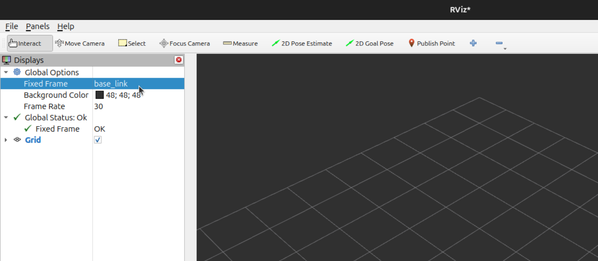
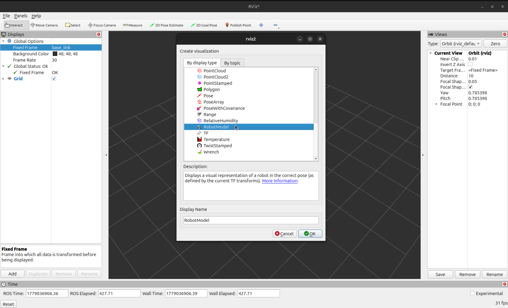
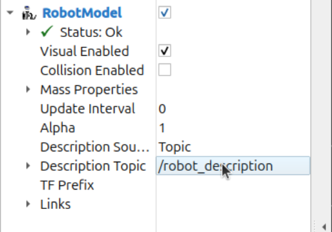
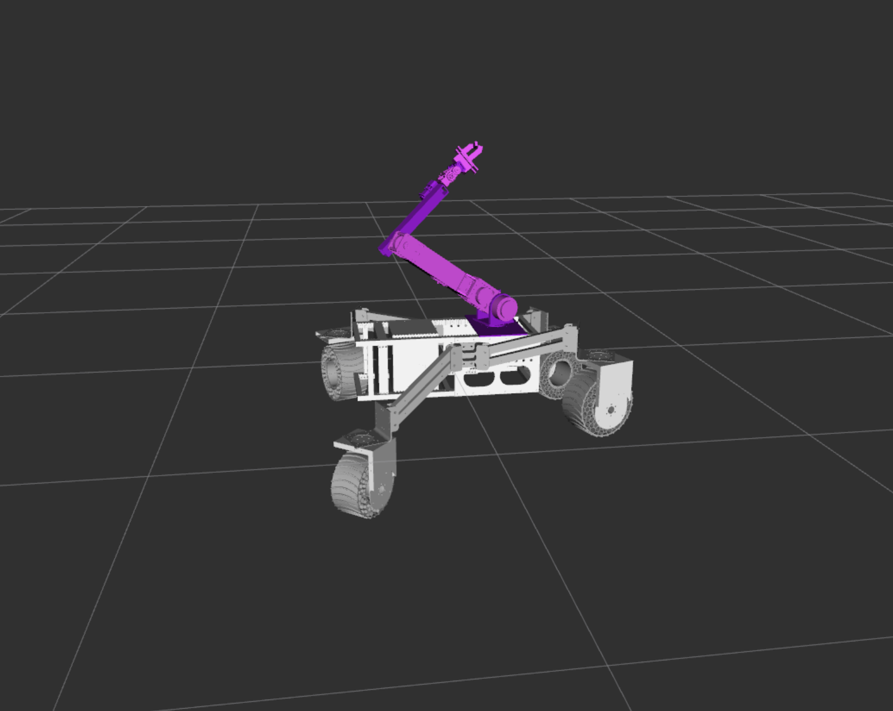

# proxima_common
Packages common to both physical and simulated Proxima robot.

## Test moteusów

W `proxima_description/` (katalogi `config/`, `launch/`, `robots/`) są pliki `moteus_test*`: szybko wygenerowany xacro i launch do testu samego manipulatora (3 × moteus, CAN ID 1–3).

<<<<<<< HEAD
Stan kodu: `MoteusSystem` łączy się z moteusami i odczytuje pozycję, prędkość i moment. `write()` nie jest jeszcze zaimplementowany, więc silniki się **nie ruszają**.

### Przygotowanie (jednorazowo)
=======
```
colcon build --packages-select proxima_description
source install/setup.bash # or .zsh
```
with that you can run proxima with an arm:
```
ros2 launch proxima_description display.launch.py manipulator:=6DOF
```
or without:
```
ros2 launch proxima_description display.launch.py
```
Now that rviz is running, change `Fixed Frame` to `base_link` in the top right corner:

next click `Add` from the bottom left corner, select `RobotModel` and click `OK`:

In the `Displays` a new `RobotModel` section shoud appear, expand it and change `Description Topic` to `/robot_description`



After you click somewhere else on the screen, rvis will update the visualization and display proxima. you can change joint states with `Joint State Publisher` that appeared in another window. Enjoy!!

### Topics
List of all joints in proxima:
- rod_front_right_upper_joint
- fork_front_right_joint
- wheel_front_right_joint
- rod_front_left_upper_joint
- fork_front_left_joint
- wheel_front_left_joint
- rod_rear_right_upper_joint
- fork_rear_right_joint
- wheel_rear_right_joint
- rod_rear_left_upper_joint
- fork_rear_left_joint
- wheel_rear_left_joint
>>>>>>> 2caf3bb (lord have mercy on my poor soul 🙏)

Dostęp do fdcanusb bez roota:
```bash
echo 'SUBSYSTEM=="tty", ATTRS{manufacturer}=="mjbots", ATTRS{product}=="fdcanusb", MODE="0666", SYMLINK+="fdcanusb"' \
  | sudo tee /etc/udev/rules.d/99-fdcanusb.rules
sudo udevadm control --reload-rules && sudo udevadm trigger
```
Po wykonaniu odłącz i podłącz fdcanusb ponownie.

### Build

```bash
source /opt/ros/jazzy/setup.bash
colcon build --packages-select proxima_manip_controller proxima_description
source install/setup.bash
```

### Test bez silników

Sprawdza, czy URDF, launch i kontrolery działają:
```bash
ros2 launch proxima_description moteus_test.launch.py use_mock_hardware:=true
```

### Test z silnikami

```bash
ros2 launch proxima_description moteus_test.launch.py
```

W logach powinny pojawić się 3 linie `Moteus id X OK: ...`.

W drugim terminalu (po `source install/setup.bash`):
```bash
ros2 control list_hardware_components
ros2 topic echo /joint_states
```
Po obróceniu wału ręką pozycja odpowiedniego jointa powinna się zmieniać (w radianach).

### Gdy coś nie działa

- `Permission denied` przy fdcanusb: wykonaj krok z udev.
- `No reply from moteus id X`: sprawdź silnik poza ROS-em:
```bash
  python3 -m moteus.moteus_tool --target X --info
```